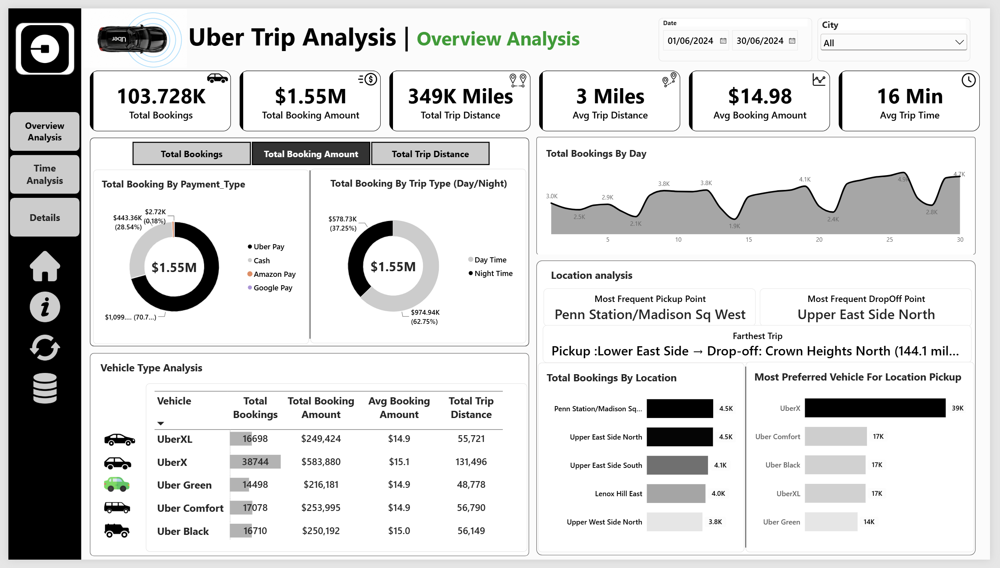
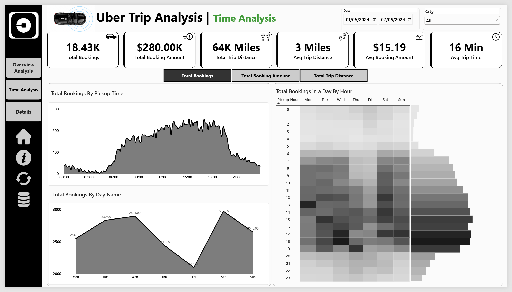
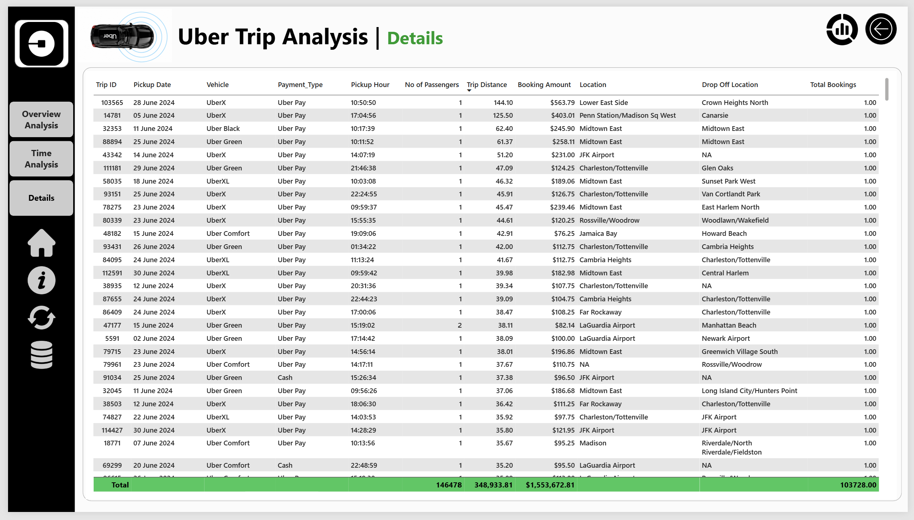

<div align="center">


# 🚖 Uber Trip Analysis — Power BI Dashboard & Business Insights

*Analysing 103K+ Uber bookings to uncover booking trends, vehicle performance, payment preferences, and location-based demand using interactive Power BI dashboards.*


</div>

## 1. 📌 Project Overview

This project analyses Uber trip data for **June 2024** using Power BI to understand booking performance, trip distances, vehicle categories, payment preferences, and location-based demand.

The report transforms trip-level data into an interactive business intelligence dashboard, helping users compare performance across time periods, vehicle types, payment methods, and pickup locations.

## 2. 🎯 Business Questions

- How do booking volumes change throughout the day and across weekdays?
- Which vehicle types contribute the most bookings, booking amounts, and trip distances?
- Which payment methods account for the largest share of booking amounts?
- Which pickup locations record the highest booking activity?
- How can these patterns support further investigation into demand and operational planning?

## 3. 📊 Key Findings & Insights

### Headline Metrics

| 🚖 Total Bookings | 💵 Booking Amount | 🛣️ Total Distance | 📏 Avg Distance | 🏷️ Avg Booking Amount | ⏱️ Avg Trip Time |
|:---:|:---:|:---:|:---:|:---:|:---:|
| **103,728** | **~$1.55M** | **348,934 miles** | **~3 miles** | **$14.98** | **16 min** |

### Key Insights

- **103,728 total bookings** and approximately **$1.55M in booking amount**.
- **348,934 miles** in total trip distance, with an average trip distance of approximately **3 miles**.
- **$14.98 average booking amount** and **16 minutes average trip time**.
- **UberX** led the displayed vehicle categories with **38,744 bookings**, approximately **$583.9K in booking amount**, and **131,496 miles** in trip distance.
- **Daytime trips** accounted for approximately **62.75% of the displayed booking amount**, compared with 37.25% for night time trips.
- **Penn Station/Madison Sq West** and **Upper East Side North** were among the leading pickup locations, each showing approximately **4.5K bookings**.

*Figures reflect the published dashboard and depend on the underlying DAX measures and active filters.*

## 4. 💡 Business Recommendations

- **Demand planning:** Investigate peak booking hours and weekday patterns to assess whether driver availability aligns with demand.
- **Vehicle allocation:** Examine UberX's higher booking volume when reviewing vehicle availability and category-level demand.
- **Location strategy:** Explore high-volume pickup areas to identify recurring demand patterns.
- **Payment monitoring:** Track payment-method usage and booking amounts over time to identify meaningful changes.
- **Data quality:** Review unusually long trips and extreme values before using distance metrics for operational decisions.

*These are opportunities for further investigation, not claims of proven business impact.*

## 5. 🖼️ Dashboard Preview

### Overview Analysis



Summarises booking KPIs, payment preferences, daytime versus nighttime performance, daily booking trends, vehicle comparisons, and pickup/drop-off locations.

### Time Analysis



Explores booking activity by pickup hour and weekday, helping users compare temporal patterns and identify periods for further investigation.

### Trip Details



Provides a detailed view of individual trip records, including vehicle type, payment type, passenger count, trip distance, booking amount, and pickup/drop-off locations.

## 6. 🛠️ Tools & Technical Skills

- **Microsoft Power BI** — interactive reports, KPI cards, filters, and dashboard navigation.
- **DAX** — calculations for booking volume, booking amounts, distances, and average metrics.
- **Data Visualisation** — KPI cards, donut charts, trend charts, bar charts, and heatmaps.
- **Exploratory Data Analysis** — comparisons across time, vehicles, payments, and locations.
- **Business Intelligence** — translating observed patterns into business questions and recommendations.
- **Data Validation** — checking dashboard figures against the underlying dataset.

## 7. ⚙️ Methodology & Workflow

1. **Data inspection:** Reviewed the available trip fields and their suitability for analysis.
2. **Data preparation:** Prepared the source data and relevant analytical fields used in the report.
3. **KPI analysis:** Examined bookings, booking amounts, trip distances, and average metrics.
4. **Comparative analysis:** Evaluated results by vehicle type, payment method, time, and pickup location.
5. **Dashboard development:** Built three interactive Power BI pages for overview reporting, time analysis, and trip-level details.
6. **Validation and interpretation:** Reviewed displayed metrics and identified patterns for further investigation.

## 8. 📂 Dataset Overview

| Attribute                  | Details                                                                                                                     |
| -------------------------- | --------------------------------------------------------------------------------------------------------------------------- |
| Dataset                    | Uber trip data supplied with the project                                                                                    |
| Reporting period           | June 2024                                                                                                                   |
| Total bookings shown       | 103,728                                                                                                                     |
| Total booking amount shown | Approximately $1.55M                                                                                                        |
| Total trip distance shown  | Approximately 348,934 miles                                                                                                 |
| Key fields                 | Pickup date, vehicle type, payment type, passenger count, trip distance, booking amount, pickup location, drop-off location |
| Analysis tool              | Microsoft Power BI                                                                                                          |

## 9. 📁 Repository Structure

```text
USA-Uber-Data-Analysis/
├── Business Problem/
│   └── Problem Statement.docx
├── Data/
│   ├── Location Table.xlsx
│   └── Uber Trip Details.xlsx
├── Data Analysis and Dashboard/
│   └── NewYork Uber Trip Data Analysis.pbix
├── Images/
│   ├── Overview_Analysis_Dashboard.png
│   ├── Time_Analysis_Dashboard.png
│   ├── Details_Dashboard.png
│   ├── Uber Logo.png
│   ├── Uber Car Logo.png
│   ├── UberX.png
│   ├── UberXL.png
│   ├── comfort.png
│   ├── suv.png
│   ├── green.png
│   ├── sales.png
│   ├── money.png
│   ├── distance.png
│   ├── avg_distance.png
│   ├── clock.png
│   ├── Home.png
│   ├── Data.png
│   ├── Info.png
│   ├── Bookmark.png
│   └── Refresh.png
├── LICENSE
└── README.md
```

## 10. 🚀 How to Run / Explore

1. Clone or download this repository.
2. Open `Data Analysis and Dashboard/NewYork Uber Trip Data Analysis.pbix` in **Power BI Desktop** (free, Windows).
3. If prompted, update the source-data path to the dataset in the `Data/` folder.
4. Refresh the report if required and resolve any data-source prompts.
5. Explore the Overview Analysis, Time Analysis, and Trip Details pages using the available filters.

## 11. ⚠️ Limitations & Assumptions

- **Reporting period:** The overview shows June 2024, while some time-analysis visuals use a narrower date selection.
- **Booking amount:** This is not equivalent to profit or net revenue because operating costs and other financial components are not established by the dashboard.
- **Metric definitions:** Results depend on the underlying DAX measures, source data, and active filters.
- **Interpretation:** Observed patterns do not establish their causes or prove that a particular operational change would improve performance.
- **Data provenance:** Verify the original dataset source and redistribution permissions before publishing the data publicly.